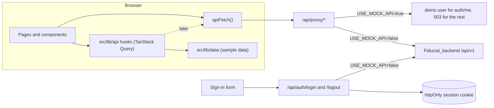

# Design: frontend shell

## Overview

The shell extends the existing Next.js 16 app. Sign-in, the BFF routes and `src/proxy.ts` stay; mock mode is added
to them. The signed-in layout, the theme system and the dashboard are new. Proposal data comes from a typed sample
data layer that components reach only through TanStack Query hooks. Replacing the sample data with API calls later
changes `src/lib/api` and nothing else.

Requirement numbers refer to [requirements.md](requirements.md). The design was approved on 5 Oct 2026; the answers
to Q1 to Q8 are listed at the end and are folded into the sections below.

### Decisions and deviations from the brief

| #   | Brief                                                                | This design                                                                                                                                                              | Why                                                                                                                                                                      |
| --- | -------------------------------------------------------------------- | ------------------------------------------------------------------------------------------------------------------------------------------------------------------------ | ------------------------------------------------------------------------------------------------------------------------------------------------------------------------ |
| D1  | `apps/web`                                                           | `Fiducial_frontend`                                                                                                                                                      | The monorepo was split; this repo is the former `apps/web`.                                                                                                              |
| D2  | `middleware.ts`                                                      | Keep `src/proxy.ts`                                                                                                                                                      | Next.js 16 renamed middleware to proxy. Same behaviour, already in place.                                                                                                |
| D3  | Types in `packages/shared`, else `src/types`                         | `src/types/proposal.ts`                                                                                                                                                  | `src/shared` is an exact copy of the backend's contracts (CI checks it) and there is no proposals API yet. The types move to `Fiducial_backend/src/shared` with the API. |
| D4  | Sidebar "New Proposal", "Existing Proposals"                         | Both link to a new list page, `/proposals?type=new` and `/proposals?type=existing`                                                                                       | Creation forms are out of scope, and breadcrumbs need a parent for `/proposals/{id}`. Approved (Q2).                                                                     |
| D5  | Occupancy, Pincodes "can link to placeholder pages"                  | Link to the existing working pages                                                                                                                                       | They already exist. In mock mode they show "Not available in demo mode".                                                                                                 |
| D6  | Navigation has no Fire rate check                                    | Keep it, under Workflow                                                                                                                                                  | Existing working feature. Approved (Q5).                                                                                                                                 |
| D7  | New dashboard replaces the current one                               | System status and Master data cards move to Settings (admin); the "Signed in as" card moves to Profile                                                                   | Keeps every current feature. Approved (Q5).                                                                                                                              |
| D8  | Navigation groups                                                    | The planned Clients and Risks items are dropped                                                                                                                          | The brief's groups replace them.                                                                                                                                         |
| D9  | `USE_MOCK_API` returns a demo user                                   | Two demo users (Admin and Account Manager). Mock mode never forwards to the API                                                                                          | The second user shows the Admin group is role-based. Public demo credentials can never reach real data.                                                                  |
| D10 | Accent #2A7F8E                                                       | Kept for fills, icons and focus rings. Accent-coloured text uses `--accent-strong` (#226F7C in light)                                                                    | #2A7F8E on the #F6F8FB background is 4.36:1, below AA for text.                                                                                                          |
| D11 | Border #E2E8F0                                                       | Kept for dividers. Form fields use `--input` (#7B8798 light, #64758C dark)                                                                                               | Field borders need 3:1 (WCAG 1.4.11); #E2E8F0 on white is 1.23:1.                                                                                                        |
| D12 | "trend or helper text"                                               | Helper text only                                                                                                                                                         | Sample data has no history; invented trends would mislead.                                                                                                               |
| D13 | Pagination or load more                                              | Pagination, 5 rows per page                                                                                                                                              | 7 sample proposals per type would otherwise fit on one page. Use 25 with the API.                                                                                        |
| D14 | Collapsed state persists                                             | Stored in a cookie that the server layout reads                                                                                                                          | No layout shift on load. The cost: signed-in pages render per request instead of being prerendered (see Risks).                                                          |
| D15 | Command palette, no extra UI libraries without asking                | shadcn/ui Command, built on `cmdk`                                                                                                                                       | `cmdk` is the library behind shadcn's Command. Approved (Q1).                                                                                                            |
| D16 | Recharts                                                             | Recharts 3 plus its `react-is` peer                                                                                                                                      | Required peer dependency.                                                                                                                                                |
| D17 | `?type=` in the URL                                                  | Also `?stage=`; both written with `history.replaceState`                                                                                                                 | A stage filter is worth linking too. Switching does not add history entries.                                                                                             |
| D18 | "about 12" mock proposals                                            | 14 (7 new, 7 existing)                                                                                                                                                   | Room for every stage and product in each type with some variation between stages.                                                                                        |
| D19 | A few Testing Library tests, Playwright if time allows               | Also property tests for the pure logic: money, dates, sample data, listing, URL state, mock mode and redirects                                                           | The sample data moves with the calendar and the formatters have edge cases; generated inputs find cases fixed examples miss. Approved (Q8).                              |
| D20 | "Total sum insured" column                                           | "Fire SI (Proposed 1)": the Fire section's Proposed 1 sum insured, in the table, the KPI helper texts and the chart. The drawer still shows every section and its totals | Approved (Q4). Whether the product test uses total or per-location sum insured is an open client question (document 06, Q04).                                            |
| D21 | Expiry chip: over 60 days neutral, 30 to 60 warning, under 30 danger | Danger from 0 to 30 days and for expired policies, warning from 31 to 60, neutral above 60. Placed renewals are neutral and never count as due                           | Approved (Q3). The chip windows now match the "Renewals due" cards.                                                                                                      |
| D22 | Playwright smoke test "if time allows"                               | One smoke test, Chromium only, in `npm run test:e2e` and its own CI job with a cached browser                                                                            | Approved (Q6). `npm test` stays fast and needs no browser.                                                                                                               |

## Architecture



### Rendering and providers

- `src/app/layout.tsx` (server) renders `<html lang="en-IN" suppressHydrationWarning>` around `Providers`.
- `providers.tsx` (client), outermost first: next-themes `ThemeProvider`, TanStack `QueryClientProvider`, Radix
  `TooltipProvider`, then the page and the `Toaster`.
- `(auth)/layout.tsx` (server) renders the sign-in frame per request, so it can read `USE_MOCK_API` (see Sign-in
  page).
- `(app)/layout.tsx` (server) reads the `erp_sidebar` cookie and `isMockApi()` and renders `AppShell` (client), which
  provides demo mode to the pages. Reading the cookie makes signed-in pages render per request; today they are
  prerendered.
- Each page is a server `page.tsx` that awaits `params` and `searchParams` and renders a client `*-view.tsx`, as the
  existing pages do.
- Nothing is fetched on the server. Client components call the hooks in `src/lib/api`. Today those read the sample
  data in the browser; later they call `apiFetch`, which goes through `/api/proxy` as the masters pages do now. The
  server render shows the loading states.

### Authentication and mock mode

`src/lib/server/mock-mode.ts` (server only) holds `isMockApi()` (`process.env.USE_MOCK_API === 'true'`), the demo
users and the mock token helpers.

| Demo user                  | Name       | Role            | Password (both)      |
| -------------------------- | ---------- | --------------- | -------------------- |
| `demo.admin@example.com`   | Asha Menon | ADMIN           | `Fiducial-demo-2026` |
| `demo.manager@example.com` | Rahul Iyer | ACCOUNT_MANAGER | `Fiducial-demo-2026` |

- Demo users have fixed 24-character hex ids and fixed dates, because the shared `UserSchema` requires an ObjectId
  and ISO date-times. Their `auth/me` responses pass the same schema as real ones.
- Login, in mock mode: same-origin check, then the same `LoginRequestSchema`. The password is compared with
  `crypto.timingSafeEqual` on SHA-256 digests. A mismatch returns 401 with `INVALID_CREDENTIALS`. A match sets the
  usual cookie with the token `mock.<user id>.<random UUID>` for 8 hours and returns `{ user }`.
- Proxy, in mock mode: no cookie gives 401 (as today). A token that is not `mock.<demo user id>.<UUID>` gives 401
  and clears the cookie. `auth/me` returns the demo user. Every other allowed path returns 503 with code
  `DEMO_MODE`. Paths outside the allowlist still return 404, and the same-origin check (403) still runs before the
  mock branch.
- `DEMO_MODE_CODE` and `isDemoModeError()` live in `src/lib/demo-mode.ts`, not in `src/shared`: that folder is a copy
  of the backend's contracts, and `npm run shared:check` fails on any local change.
- Logout, in mock mode: clears the cookie and does not call the API.
- `src/proxy.ts`: public paths are `/login` and `/forgot-password`. A signed-in visit to `/login` goes to
  `/dashboard`. Other pages without a cookie go to `/login?next=…`.
- Client: `(app)/layout.tsx` passes `demoMode` to AppShell, which provides it through `DemoModeProvider` (`src/hooks/use-demo-mode.tsx`). The masters,
  rating, users and settings pages render `DemoModeState` ("Not available in demo mode: this page reads live data
  from Fiducial_backend") at once through `DemoModeGate`, without sending requests that can only fail. `isDemoModeError(error)` is the
  fallback for any request that still gets `DEMO_MODE`, and the query client's retry rule in `providers.tsx` skips
  those errors (today it retries every 5xx twice).
- Sign-in, in demo mode: the page passes `demoMode` to the form, which shows the plain invalid-credentials message
  without the lockout sentence, since mock mode has no lockout.
- Safety: the code default is off. Outside mock mode a `mock.` token reaches the API, which rejects it with 401, and
  the proxy clears the cookie. The README warns never to enable mock mode where real users sign in.

### Dependencies

New packages, pinned exactly. Versions are the latest on npm on 5 Oct 2026; sizes are bundlephobia's gzipped figures.
Each exact version is checked on npm before it is installed; if one does not resolve, work stops for a decision
instead of substituting another version.

| Package            | Version | Notes                                                                                                                     |
| ------------------ | ------- | ------------------------------------------------------------------------------------------------------------------------- |
| `next-themes`      | 0.4.6   | Supports React 19. 1.5 kB. No release since March 2025 (see Risks).                                                       |
| `recharts`         | 3.10.1  | Supports React 19. About 148 kB, so it loads only with the chart.                                                         |
| `react-is`         | 19.3.0  | Recharts peer dependency, matched to React.                                                                               |
| `cmdk`             | 1.1.1   | Approved (Q1). About 15 kB with its dependencies; it reuses the installed Radix Dialog (1.1.23 meets its `^1.1.6` range). |
| `fast-check`       | 4.10.2  | Dev only, approved (Q8). Generates the inputs for the property tests.                                                     |
| `@playwright/test` | 1.63.0  | Dev only, approved (Q6). Chromium is the only browser installed.                                                          |

Unchanged: Next.js 16.3.8 (current stable), React 19.3.0, TypeScript 6.0.3, Tailwind CSS 4.3.3, `radix-ui` 1.6.7
(Tooltip, Tabs, Dialog and the other primitives come from here), TanStack Query 5.104.1, React Hook Form 7.89.0, Zod
4.6.5, lucide-react 1.52.0.

### Routes and files

```
src/app/
  layout.tsx                    <html suppressHydrationWarning>
  providers.tsx                 + ThemeProvider, TooltipProvider
  globals.css                   light and dark tokens, dark variant
  (auth)/                       route group, no URL segment
    layout.tsx                  two-column layout, theme control, demo notice
    login/                      page.tsx, login-form.tsx (moved from app/login)
    forgot-password/page.tsx    placeholder
  (app)/
    layout.tsx                  reads the sidebar cookie and mock mode, renders AppShell
    error.tsx                   error state inside the shell for unexpected render errors
    dashboard/                  page.tsx, dashboard-view.tsx, kpi-cards.tsx, stage-chart.tsx, dashboard-header.tsx
    proposals/page.tsx          list for ?type=
    proposals/new/page.tsx      placeholder for "New proposal" and "Start renewal"
    proposals/[id]/page.tsx     full proposal with tabs
    settings/page.tsx           admin: system status and master versions (moved from the dashboard)
    profile/page.tsx            account card and a "planned" note
    masters/, rating/, users/   unchanged
  api/auth/login, api/auth/logout, api/proxy/[...path]   + mock mode
src/components/
  layout/      app-shell, sidebar/ (sidebar, sidebar-nav, sidebar-user), mobile-nav, navbar, breadcrumbs,
               command-palette, notifications-menu, user-menu, theme-toggle, theme-provider, demo-badge, nav-config.ts
  proposals/   type-switch, pipeline-strip, proposals-table/ (table, toolbar, header-cell, pagination),
               proposal-drawer, proposal-tabs, badges (type, stage, quote, document, expiry chip),
               sections/ (summary, stage-stepper, coverage-table, add-ons, clauses-excess, insurer-quotes,
               documents, activity)
  ui/          + tooltip, tabs, breadcrumb, command, native-select, kbd, separator; dropdown-menu gains
               RadioGroup and RadioItem (theme control)
  states.tsx   + DemoModeState, AccessDeniedState
  demo-mode-gate.tsx   shows DemoModeState in place of pages that need the API
  settings/, profile/  the cards moved from today's dashboard
src/lib/
  api/         proposals.ts, notifications.ts, latency.ts
  data/        proposals.ts, notifications.ts, catalogues.ts
  money.ts, dates.ts, proposal-metrics.ts, proposal-params.ts, use-url-search-params.ts
  demo-mode.ts DEMO_MODE_CODE and isDemoModeError(), shared by the BFF routes and the browser
  server/      mock-mode.ts (server only: isMockApi(), demo users, mock tokens)
src/hooks/
  use-demo-mode.tsx    DemoModeProvider and useDemoMode()
  use-ist-now.ts       the current time, read in the browser only (greeting, date, relative times)
src/types/proposal.ts
playwright.config.ts, e2e/smoke.spec.ts   Chromium smoke test (npm run test:e2e)
```

`src/components/app-shell/` is replaced by `src/components/layout/`.

## Components and Interfaces

### Theme and tokens

#### Tokens

Values in bold come from the brief. Ratios are WCAG 2.x contrast ratios, computed for this design. A unit test
recomputes them from `globals.css` (see Testing Strategy).

| Token                                    | Light             | Dark              | Used for                                                 | Contrast (light / dark)                             |
| ---------------------------------------- | ----------------- | ----------------- | -------------------------------------------------------- | --------------------------------------------------- |
| `--background`                           | **#F6F8FB**       | **#0E1621**       | Page                                                     |                                                     |
| `--card`, `--popover`                    | **#FFFFFF**       | **#151F2D**       | Cards, drawers, menus                                    |                                                     |
| `--foreground` (and `card-`, `popover-`) | **#0F172A**       | **#E6EDF5**       | Body text                                                | 16.78 on page, 17.85 on card / 15.40, 14.06         |
| `--muted`                                | #EEF2F6           | #1C2838           | Table header, hover, skeleton                            |                                                     |
| `--muted-foreground`                     | **#5B6B7F**       | **#94A3B8**       | Secondary text                                           | 5.12 page, 5.45 card, 4.84 muted / 7.09, 6.47, 5.81 |
| `--border`                               | **#E2E8F0**       | **#243244**       | Dividers (decorative)                                    |                                                     |
| `--input`                                | #7B8798           | #64758C           | Form field borders                                       | 3.65 card, 3.43 page / 3.53, 3.86                   |
| `--ring`                                 | #2A7F8E           | #4FB3C3           | Focus ring                                               | 4.64 card, 4.36 page / 6.77, 7.42                   |
| `--primary`                              | **#1F3A5F**       | **#7FA7D9**       | Primary buttons, links, active states                    | as text 10.79 page, 11.48 card / 7.30, 6.66         |
| `--primary-foreground`                   | #FFFFFF           | #0E1621           | Text on primary                                          | 11.48 / 7.30                                        |
| `--primary-soft`                         | #E8EEF6           | #1D2D44           | Selected chips, default badge                            | primary text on it 9.84 / 5.58                      |
| `--accent`                               | **#2A7F8E**       | **#4FB3C3**       | Accent fills, icons, brand mark                          | white on it 4.64 / dark text 7.42                   |
| `--accent-foreground`                    | #FFFFFF           | #0E1621           | Text on accent                                           |                                                     |
| `--accent-soft`                          | #E5F2F4           | #143039           | Accent badge background                                  |                                                     |
| `--accent-strong`                        | #226F7C           | #4FB3C3           | Accent-coloured text                                     | 5.43 page, 5.78 card, 5.05 soft / 6.77, 5.67        |
| `--secondary` / `-foreground`            | #EEF2F6 / #1F3A5F | #1C2838 / #E6EDF5 | Secondary buttons                                        | 10.21 / 12.62                                       |
| `--success` / `--success-soft`           | #1E6B45 / #E6F4EC | #74D3A0 / #12301F | Quoted, Approved                                         | 5.71 on soft, 6.47 card / 7.88, 9.14                |
| `--warning` / `--warning-soft`           | #8A4B08 / #FDF3E2 | #F0C36A / #36290F | Due in 31 to 60 days, No response                        | 6.18, 6.79 / 8.59, 10.05                            |
| `--destructive` / `--destructive-soft`   | #B42318 / #FDECEA | #F59E9E / #3A1A1E | Danger: due in 0 to 30 days or expired, Declined, errors | 5.75, 6.57 / 7.63, 8.11                             |
| `--destructive-foreground`               | #FFFFFF           | #0E1621           | Text on solid danger buttons                             | 6.57 / 8.89                                         |
| `--info` / `--info-soft`                 | #1D5B8F / #E6F0F9 | #8EC5F0 / #12283F | Sent, Ready, notices                                     | 6.18, 7.13 / 8.13, 9.00                             |
| `--chart-1`                              | #1F3A5F           | #7FA7D9           | Proposals by stage                                       | 11.48 / 6.66 on card                                |
| `--chart-2`                              | #2A7F8E           | #4FB3C3           | Sum insured by product                                   | 4.64 / 6.77                                         |
| `--chart-3`, `--chart-4`                 | #5E7FAE, #B07A1F  | #A7B8E8, #E0B060  | Reserved for later series                                | 4.10, 3.72 / 8.43, 8.33                             |
| `--sidebar`                              | #1F3A5F           | #111A27           | Sidebar surface (navy in light, as today)                |                                                     |
| `--sidebar-foreground`                   | #E6EDF5           | #E6EDF5           | Sidebar text                                             | 9.73 / 14.82                                        |
| `--sidebar-muted`                        | #A9BBD0           | #94A3B8           | Group titles, Planned items                              | 5.85 / 6.82                                         |
| `--sidebar-active`                       | #2D4F7C           | #1D2D44           | Active item background                                   |                                                     |
| `--sidebar-active-foreground`            | #FFFFFF           | #FFFFFF           | Active item text                                         | 8.33 / 13.90 on `--sidebar-active`                  |
| `--sidebar-ring`                         | #7FC6D3           | #4FB3C3           | Focus ring and active indicator in sidebar               | 5.97 on sidebar, 4.33 on active / 7.14, 5.67        |
| `--sidebar-border`                       | #2C4A70           | #243244           | Sidebar dividers                                         |                                                     |
| `--overlay`                              | #0F172A           | #020617           | Dialog and drawer backdrop (`bg-overlay/50`)             | decorative                                          |

The token set also fixes existing code that is below AA today or would break in dark mode:

- `--input` (#C3CCD7 today) is 1.62:1 on white; the new value is 3.65:1.
- The sidebar's active indicator (accent on today's #2A4A73) is 1.95:1. It becomes `--sidebar-ring`, 4.33:1 on the
  active background.
- `ui/dialog.tsx` and `ui/sheet.tsx` darken the page with `bg-foreground/40`, which becomes a light veil in dark mode.
  They switch to `bg-overlay/50`.
- The sidebar brand and active item use `text-primary-foreground`, which is #0E1621 in dark mode (1.04:1 on the dark
  sidebar). Sidebar text uses the `sidebar-*` tokens only; the brand mark keeps `accent` and `accent-foreground`.
- Accent-coloured text (Badge `accent`, Button `link`, the occupancy code buttons, the sign-in heading) moves from
  `text-accent` to `text-accent-strong`. Icons keep `text-accent`.
- The Input focus ring is `ring-ring/40` (1.71:1 on white). It becomes a solid `ring-ring`, like the other controls,
  and the sidebar's `ring-accent` becomes `ring-sidebar-ring`.

#### Implementation

- `globals.css` defines `:root` (light) and `.dark` blocks, maps every token in `@theme inline`, and declares the
  dark variant with `@custom-variant dark (&:where(.dark, .dark *));`.
- `providers.tsx` wraps the app in next-themes'
  `<ThemeProvider attribute="class" defaultTheme="system" enableSystem disableTransitionOnChange storageKey="erp-theme">`.
  next-themes runs a small inline script before first paint, which prevents the flash, and sets `color-scheme` so
  native controls and scrollbars match. `<html>` gets `suppressHydrationWarning`, because the script changes its
  class before React hydrates.
- `ThemeToggle` is a DropdownMenu with a radio group (Light, Dark, System), opened by an icon button named "Theme".
  Its icon switches with `dark:` classes rather than JavaScript, so server and client markup match. The checked item
  comes from `useTheme()`, which is read only once the menu opens in the browser. It is used in the navbar and the
  auth layout.
- Typography stays on the system font stack. Amount, count and date cells use `tabular-nums`.
- Motion: the `prefers-reduced-motion` rule in `globals.css` gains `animation-iteration-count: 1` and
  `scroll-behavior: auto`. Today it only shortens durations, which leaves infinite animations such as the skeleton
  pulse cycling. Animations use `motion-safe:` where they are optional.
- Known issue: next-themes 0.4.6 renders its inline script through React, and React 19.2 and later report
  "Encountered a script tag while rendering React component" in development. With Next.js 16.2 and later the dev
  overlay shows it on every page load ([shadcn-ui/ui#10104](https://github.com/shadcn-ui/ui/issues/10104)), so it will
  appear with this stack (Next.js 16.3.8, React 19.3.0). It is a false positive: the script runs during server
  rendering. `theme-provider.tsx` filters that one console message when `NODE_ENV` is `development`. Production is not
  affected.

### Signed-in layout

#### Composition

`(app)/layout.tsx` is a server component. It reads the `erp_sidebar` cookie and `isMockApi()`, and renders
`<AppShell defaultCollapsed demoMode>`. AppShell is a client component that renders the frame at once: skip link,
sidebar, navbar and `<main id="main">`. Parts that need the user (the Admin group, the sidebar footer, the user menu)
show skeletons until `useCurrentUser()` resolves. If loading the user fails with anything other than a 401, `main`
shows an error with retry. A 401 already sends the user to sign-in through `apiFetch`.

#### Sidebar

| Group     | Item                                   | Icon (lucide)                           | Target                                    |
| --------- | -------------------------------------- | --------------------------------------- | ----------------------------------------- |
| Overview  | Dashboard                              | `LayoutDashboard`                       | `/dashboard`                              |
| Proposals | New Proposals                          | `FilePlus2`                             | `/proposals?type=new`                     |
| Proposals | Existing Proposals                     | `RefreshCcw`                            | `/proposals?type=existing`                |
| Workflow  | RFQ · Quotes and QCR · Placement Slips | `Send`, `Scale`, `FileCheck2`           | Planned                                   |
| Workflow  | Fire rate check                        | `Flame`                                 | `/rating/fire`                            |
| Masters   | Occupancy · Pincodes                   | `Building2`, `MapPin`                   | `/masters/occupancy`, `/masters/pincodes` |
| Masters   | Add-on Covers · Clauses · Insurers     | `PackagePlus`, `ScrollText`, `Landmark` | Planned                                   |
| Admin     | Users · Settings (ADMIN only)          | `UserCog`, `Settings`                   | `/users`, `/settings`                     |

- Expanded width 240 px; rail 56 px. The aside is labelled "Sidebar" and contains `<nav aria-label="Main">`.
- The toggle lives in the navbar. At 1024 px and wider it collapses or expands the sidebar (`aria-expanded`,
  `aria-controls`, label "Collapse sidebar" or "Expand sidebar"). Below 1024 px a separate menu button opens the
  drawer. CSS decides which button shows, so no media query runs in JavaScript.
- Toggling writes `erp_sidebar=collapsed|expanded; Path=/; Max-Age=31536000; SameSite=Lax`. The cookie is not httpOnly
  because the browser writes it; it holds no secret.
- In the rail, labels become visually hidden and each item gets a Radix Tooltip on the right, which opens on hover
  and on keyboard focus. The footer shows the user's initials, with the name and role in its tooltip.
- A Planned item is a `<span role="link" aria-disabled="true" tabIndex={0}>` without `href`. Its name is the label
  plus the visible "Planned" tag (for example "RFQ Planned"), activating it does nothing, and it stays focusable so
  the rail tooltip also works from the keyboard (Requirement 6.6). Today's `<span aria-disabled>` has no role, so
  assistive technology does not report it as disabled.
- Active item: the path matches, and for the proposal items the `type` parameter matches too. On `/proposals/{id}` no
  item is active; the breadcrumbs show the location. The active style combines `--sidebar-active`, a 3 px
  `--sidebar-ring` indicator bar, `--sidebar-active-foreground` text and medium weight.
- Light mode keeps today's navy sidebar and dark mode uses a dark surface (Q7). The active marker has at least 3:1
  against the active background and the sidebar (4.33:1 and 5.97:1 in light, 5.67:1 and 7.14:1 in dark), and sidebar
  text meets AA. The contrast test checks these pairs.
- Below 1024 px the same `SidebarNav` renders in the existing left Sheet, always expanded, and the Sheet closes after
  navigation. Radix Dialog returns focus only to its own `Trigger`, and the menu button is not one, so the Sheet's
  `onCloseAutoFocus` prevents the default and focuses the menu button.

#### Navbar

`<header>` with the sidebar toggle, the breadcrumbs, a search trigger (a button styled as a field, with a ⌘K or Ctrl K
hint shown after mount), the notifications menu, the theme control and the user menu. In mock mode a "Demo mode"
badge sits next to the search trigger.

Below 640 px the search trigger becomes an icon button named "Search", the breadcrumbs show only the current page
(truncated), the user menu trigger shows the user's initials with the name as its accessible name, and the badge
reads "Demo". This keeps the bar within 360 px.

Breadcrumbs (`<nav aria-label="Breadcrumb">` with an ordered list):

| Route                                     | Breadcrumbs                                            |
| ----------------------------------------- | ------------------------------------------------------ |
| `/dashboard`                              | Dashboard                                              |
| `/proposals?type=…`                       | Proposals › New proposals or Existing proposals        |
| `/proposals/new?type=…`                   | Proposals › New proposal or Start renewal              |
| `/proposals/{id}`                         | Proposals (links to the list for its type) › reference |
| `/masters/occupancy`, `/masters/pincodes` | Masters › Occupancy or Pincodes                        |
| `/rating/fire`                            | Workflow › Fire rate check                             |
| `/users`, `/settings`                     | Admin › Users or Settings                              |
| `/profile`                                | Profile                                                |

Group names (Masters, Workflow, Admin) have no page and render as text. On `/proposals/{id}` the last crumb comes
from `useProposal(id)`, the query the page already runs, and reads "Proposal" until it resolves. The Proposals crumb
then links to the list for the proposal's type.

Notifications: `useNotifications()` returns 4 sample items built from the sample proposals (renewal due, quote
received, QCR ready for review, insurer declined) with relative times (`Intl.RelativeTimeFormat`). The bell's name
includes the unread count, for example "Notifications, 3 unread". The menu ends with "Mark all as read". The read
state is local and resets on reload.

User menu: name, email and role label; Profile (`/profile`); Sign out (the existing logout flow).

#### Command palette

- shadcn/ui `Command` (cmdk) inside the existing Dialog, with `shouldFilter={false}`.
- AppShell listens on `window` for ⌘K on macOS (`metaKey`) and Ctrl+K elsewhere (`ctrlKey`), also while focus is in a
  text field. It calls `preventDefault()`, because browsers use Ctrl+K for their own search, and toggles the palette.
  Only the platform's modifier counts, so Ctrl+K still deletes to the end of the line in macOS text fields. The
  navbar trigger opens the palette too.
- Pages group: the navigable items from `nav-config.ts` the user may see, filtered by label.
- Proposals group: `useProposals({ q, pageSize: 6 })`, enabled once the query has 2 or more characters and debounced
  by 200 ms. Each item shows reference, client and stage. Loading, error and empty messages appear inside the group.
- Choosing a page navigates there; choosing a proposal opens `/proposals/{id}`. The Dialog traps focus. The palette
  stores the focused element when it opens and focuses it again in `onCloseAutoFocus`, since it has no Radix trigger
  to return to.

#### Settings, Profile and placeholders

- `/settings` (ADMIN): the System status and Master data cards from today's dashboard. Other roles get
  `AccessDeniedState` ("You do not have access") and no request is sent. In demo mode the page shows
  `DemoModeState`.
- `/profile`: the "Signed in as" card from today's dashboard and a note that profile settings are planned.
- `/proposals/new?type=…`: a placeholder with a "Planned" badge (Q2). It says that creating a proposal (or starting a renewal) is planned, and links back to the
  list for that type.

### Sign-in page

The `(auth)` layout shows the two-column panel on screens 1024 px and wider, on `--sidebar` colours so it matches the
app in both themes, plus the theme control. In mock mode it shows an info alert with the demo credentials. It calls
`await connection()` (from `next/server`) before reading `USE_MOCK_API`, so both pages render per request. Without
it, `/forgot-password` would be prerendered at build time with the build machine's setting.

- Left panel: "Property Insurance Placement ERP", the line "From Data Sheet to Placement Slip, in one place." and
  three points: "Enter each risk once", "Rate consistently from versioned masters" and "Keep a full audit trail".
- The password field holds an icon button (`type="button"`, `aria-controls` the input) whose name switches between
  "Show password" and "Hide password". It changes the input type and leaves focus where it is.
- React Hook Form's default `shouldFocusError` focuses the first invalid field, and the shadcn `FormControl` already
  sets `aria-invalid` and `aria-describedby`. The current failure handling stays: messages for 401, 429, 502 and
  network errors, and the password cleared and focused after a failure.
- `safeNextPath()` in `src/lib/api-client.ts` is fixed. Today it only checks prefixes, so `/login?next=/%09/evil.example`
  passes: after sign-in the browser drops the tab and opens `https://evil.example/`. The hardened version first rejects any value that
  does not start with a single "/", or that contains a backslash or a control character (C0, DEL or C1). It then
  resolves the value with `new URL(next, origin)` against a placeholder origin, as the browser would, and accepts it
  only when the origin is unchanged and the path is not `/login`. It returns the resolved path, search and hash
  (Property 13). Tests cover each rejected input.
- `/forgot-password` says "Self-service password reset is not available yet. Contact your administrator for help
  signing in." and links back to sign-in.

### Dashboard

#### URL state

`useUrlSearchParams(serverSearch)` reads `window.location.search` through `useSyncExternalStore`. Its server snapshot
is the page's `searchParams` prop, so the first render matches. Writes use `history.replaceState`, which Next.js 16
keeps in sync with its router, followed by a custom event that updates the hook. The dashboard reads:

- `type`: `new` or `existing`. Missing or invalid means `new`.
- `stage`: `draft`, `data-sheet`, `rfq-sent`, `quotes-received`, `qcr` or `placed`. Missing or invalid means no
  filter.

Changing `type` removes `stage` and resets the search text and page (search and page live in component state).
`src/lib/proposal-params.ts` parses and writes both parameters; the dashboard and the list pages share it.

#### Structure

`DashboardView` holds `DashboardHeader` (a greeting such as "Good morning, Asha", from the IST hour and the first word
of the user's name; today's date in IST; the primary action), `TypeSwitch` (Radix Tabs: a tablist with two tabs, each
with its panel, counts in the tab labels), `KpiCards`, `PipelineStrip`, `StageChart` (loaded with `next/dynamic`,
client only, with a skeleton) and `ProposalsTable` with `ProposalDrawer`. A line under the heading reads "Sample data:
proposals are not connected to the API yet."

The greeting says "Good morning" before 12:00, "Good afternoon" until 17:00 and "Good evening" after, in IST. The
greeting and the date come from `useIstNow()`, a `useSyncExternalStore` hook that reads the clock only in the browser
and updates every minute. The server render and the first browser render show a skeleton in their place, so the two
always match, and the lint rule against reading the clock during render (`react-hooks/purity`) holds. The user's name
arrives after hydration anyway.

#### KPI definitions

"Open" means any stage except Placed. Days count in IST calendar days.

| Type     | Card                    | Value                                                             | Helper text                                               |
| -------- | ----------------------- | ----------------------------------------------------------------- | --------------------------------------------------------- |
| New      | Open proposals          | Open proposals                                                    | Their Fire SI (Proposed 1), compact                       |
| New      | Awaiting quotes         | Stage RFQ Sent                                                    | Number of insurers with status Sent                       |
| New      | Pending approval        | Stage QCR (QCR waiting for the manager's approval)                | Their Fire SI (Proposed 1)                                |
| Both     | Placed this month       | Stage Placed with a placed date in the current IST month          | Fire SI (Proposed 1) placed                               |
| Existing | Renewals due in 30 days | Unplaced renewals with 0 to 30 days to expiry, or already expired | Nearest: client and days                                  |
| Existing | Renewals due in 60 days | Unplaced renewals with 31 to 60 days to expiry                    | "31 to 60 days from today" and their Fire SI (Proposed 1) |
| Existing | Awaiting quotes         | Stage RFQ Sent                                                    | Number of insurers with status Sent                       |

These are display definitions for sample data, approved with Q3, not business rules. A placed renewal never counts as
due.

#### Pipeline strip

A `role="group"` labelled "Filter by stage", holding six toggle buttons with `aria-pressed`, in stage order, each
with its count. It scrolls horizontally on narrow screens. The stage select in the table toolbar writes the same
`stage` parameter.

#### Chart

One card with small Radix Tabs: "Proposals by stage" and "Sum insured by product". Recharts `BarChart` in a
`ResponsiveContainer`:

- Bars use `fill="var(--chart-1)"` (stages) or `var(--chart-2)` (products). Grid lines use `--border`, axis text uses
  `--muted-foreground`, and the tooltip uses the card and popover tokens. CSS variables follow theme changes on their
  own.
- "Sum insured by product" adds up the Fire SI (Proposed 1) of each product's proposals (Q4), as BigInt rupees, and
  the card's description says so. Only the bar height uses a number (crores with 2 decimals); labels and
  tooltips use `formatInrCompact`.
- Accessibility: the SVG is `aria-hidden` with `accessibilityLayer={false}`. A visually hidden table next to it holds
  the same values, and the card's heading names the figure.

#### Proposals table

| Column               | Content                                                   | Sort key                       |
| -------------------- | --------------------------------------------------------- | ------------------------------ |
| Reference            | Button that opens the drawer (name: reference and client) | reference                      |
| Client               | Name, city in muted text                                  | client name                    |
| Type                 | Badge: New or Renewal                                     | not sortable                   |
| Product              | Code, with the full name in a visually hidden span        | product                        |
| Fire SI (Proposed 1) | Compact, right-aligned, tabular                           | BigInt value                   |
| Sections             | `6/14`                                                    | count                          |
| Stage                | Stage badge                                               | stage order                    |
| Insurers             | `3/5` responded, or "None yet"                            | responded count                |
| Due or renewal       | Date; renewals add the days-to-expiry chip                | date (default, earliest first) |
| Owner                | Name                                                      | owner                          |

- Toolbar: search (debounced 250 ms, reference or client), stage select (a native `<select>` styled with tokens), and
  a result count announced politely.
- Sorting: each sortable header holds a button. The `<th>` carries `aria-sort`. Ties are broken by reference, so the
  order is stable and pages never overlap.
- Pagination: 5 per page, Previous and Next, "Showing 1–5 of 7".
- Rows: hover style, and clicking anywhere on a row focuses its Reference button and opens the drawer. The drawer
  keeps that button and focuses it again in `onCloseAutoFocus`, because it has no Radix trigger.
- Expiry chip (Q3): danger from 0 to 30 days and for expired policies, warning from 31 to 60, neutral above 60, and
  neutral for a placed renewal whatever its date. Text reads "1 day", "45 days", "Today" or "Expired 3 days ago".
  `expiryUrgency()` and `expiryLabel()` in `proposal-metrics.ts` decide both, and the Renewals due cards use the same
  windows.
- Wrapper: `role="region"`, `aria-label="Proposals"`, `tabIndex={0}`, `overflow-x-auto`.
- States: `TableLoadingRows` while loading; an empty state with "Clear filters" when filters are active, otherwise the
  type's primary action; `ErrorState` with retry.

The `/proposals` list page reuses `TypeSwitch` (as links), `ProposalsTable` and `ProposalDrawer`, without KPIs,
pipeline or chart.

### Proposal components

Each section is one component in `src/components/proposals/sections/`, taking `proposal: Proposal`. The drawer stacks
them; the full page shows them in tabs. Nothing is duplicated.

| Section          | Drawer | Full page tab       | Content                                                                                                             |
| ---------------- | ------ | ------------------- | ------------------------------------------------------------------------------------------------------------------- |
| Summary          | Yes    | Overview            | Type badge, product (code and name), policy period, stage, owner; renewals: existing insurer, policy number, expiry |
| Stage stepper    | Yes    | Overview            | `<ol>` of six steps; done, current (`aria-current="step"`) and upcoming, with text labels                           |
| Coverage         | Yes    | Coverage            | Table of 14 sections; "Included" or "Not included"; option columns by type; totals row                              |
| Add-ons          | Yes    | Add-ons             | "4 of 20 selected" and the first 5 names in the drawer; all selected names on the page                              |
| Clauses, excess  | Yes    | Clauses and Excess  | Counts, first 3 clause names in the drawer; full lists on the page                                                  |
| Insurers, quotes | Yes    | Insurers and Quotes | Up to 5 insurers, status badge, last update                                                                         |
| Documents        | Yes    | Documents           | Four documents, status badge, disabled "Download" with "Coming soon"                                                |
| Activity         | Last 5 | Activity (all)      | Time, actor, event, newest first                                                                                    |

- Coverage columns come from the proposal's type through the discriminated union (see Data Models), using
  `coverageColumns()` and `coverageTotals()` in `proposal-metrics.ts`, so the Existing column cannot appear for a new
  proposal. Totals use `sumRupees` over the included sections and `formatInr`. Excluded rows show "—" for amounts.
- Drawer: the existing Sheet on the right, `w-full sm:max-w-2xl`, full height. The header holds the title "client ·
  reference" and the sample-data note; the body scrolls; the footer stays visible with "Open full proposal" (a link
  that closes the drawer) and "Close". It loads with `useProposal(id)` and shows skeleton or error states.
- Full page: `/proposals/[id]/page.tsx` awaits `params` and renders the client `ProposalView`: a header (client,
  reference, type and stage badges) and Radix Tabs. "Proposal not found" covers an unknown id.

### Data layer interface (`src/lib/api/`)

| Function                  | Hook                      | Query key                       | Returns                                                           |
| ------------------------- | ------------------------- | ------------------------------- | ----------------------------------------------------------------- |
| `listProposals(params)`   | `useProposals(params)`    | `['proposals', 'list', params]` | `{ items: ProposalSummary[], total, page, pageSize }`             |
| `getProposal(id)`         | `useProposal(id)`         | `['proposals', 'detail', id]`   | `Proposal`, or `ApiError(404, 'NOT_FOUND')`                       |
| `getDashboardStats(type)` | `useDashboardStats(type)` | `['proposals', 'stats', type]`  | counts per type, KPI inputs, stage counts, sum insured by product |
| `listNotifications()`     | `useNotifications()`      | `['notifications']`             | 4 notifications                                                   |

- `params`: `{ type?, stage?, q?, sort?: { by, dir }, page?, pageSize? }`. Without `type` the search covers both
  types (the palette uses this).
- Every function awaits `delay()`: 450 ms for lists and stats, 300 ms for a single proposal. When `NODE_ENV` is
  `test` it resolves at once, without a timer. Lists use `placeholderData: keepPreviousData` so paging does not flash.
- ESLint `no-restricted-imports` blocks `@/lib/data/*` and relative paths into `lib/data` everywhere except
  `src/lib/api` and tests, which enforces "hooks only".
- Swapping in the API later means replacing each function body with `apiFetch('proposals…', { schema })` and
  deleting `src/lib/data`.

### Accessibility and responsive behaviour

- Focus: `focus-visible:ring-2 ring-ring ring-offset-2 ring-offset-background` on all controls; `ring-sidebar-ring`
  inside the sidebar.
- Landmarks: skip link, `header`, `aside` (Sidebar) with `nav` (Main), breadcrumb `nav`, `main`.
- States: `aria-current="page"` (nav, breadcrumbs), `aria-current="step"` (stepper), `aria-pressed` (pipeline),
  `aria-sort` (table), `aria-expanded` (sidebar toggle), and labelled icon buttons.
- Overlays: Radix Dialog, Sheet, DropdownMenu and Tooltip provide focus trapping and Escape. Radix returns focus only
  to its own `Trigger`, so the three overlays opened without one (mobile navigation, proposal drawer, command palette)
  return it in `onCloseAutoFocus`, as described above.
- Live regions: loading states use `role="status"`, errors `role="alert"`, and the table's result count is polite.
- Breakpoints: below 640 px the drawer is full screen, the search becomes an icon and the breadcrumbs show the current
  page only. Below 1024 px the sidebar is a drawer. KPI cards use 1, 2 or 4 columns (`sm`, `xl`).

## Data Models

### Proposal types (`src/types/proposal.ts`)

Constant arrays define the enums and Zod schemas validate them. Labels sit next to them (for example
`STAGE_LABELS`, `SECTION_LABELS`, `PRODUCT_NAMES`).

```ts
export const PROPOSAL_TYPES = ['NEW', 'EXISTING'] as const;
export const STAGES = [
  'DRAFT',
  'DATA_SHEET',
  'RFQ_SENT',
  'QUOTES_RECEIVED',
  'QCR',
  'PLACED',
] as const;
export const PRODUCTS = ['BSUS', 'BLUS', 'SFSP', 'PAR'] as const;
export const SECTION_CODES = [
  'FIRE',
  'BURGLARY',
  'FIRE_FLOATER',
  'BURGLARY_FLOATER',
  'FIRE_LOSS_OF_PROFIT',
  'MONEY',
  'FIDELITY_GUARANTEE',
  'PLATE_GLASS',
  'NEON_GLOW_SIGN',
  'ALL_RISK',
  'EEI',
  'MECHANICAL_BREAKDOWN',
  'BOILER_PRESSURE_PLANT',
  'PUBLIC_LIABILITY',
] as const;
export const SUM_INSURED_OPTIONS = ['EXISTING', 'PROPOSED_1', 'PROPOSED_2'] as const;
export const QUOTE_STATUSES = ['NOT_SENT', 'SENT', 'QUOTED', 'DECLINED', 'NO_RESPONSE'] as const;
export const DOC_STATUSES = ['NOT_STARTED', 'DRAFT', 'READY', 'SENT', 'APPROVED'] as const;
export const DOCUMENT_KINDS = ['DATA_SHEET', 'RFQ', 'QCR', 'PLACEMENT_SLIP'] as const;

/** Whole rupees as a digit string, for example "125000000". Never a float. */
export type Rupees = string;

interface ProposalBase {
  id: string; // "prp-0104"
  reference: string; // "PRP-2026-0104"
  client: { name: string; city: string };
  product: Product;
  stage: Stage;
  owner: string;
  policyPeriod: { start: IsoDate; end: IsoDate };
  addOns: { selected: string[]; catalogueSize: number };
  clauses: string[];
  excess: { section: SectionCode; note: string }[];
  insurers: { insurer: string; status: QuoteStatus; updatedAt: IsoDateTime | null }[]; // at most 5
  documents: { kind: DocumentKind; status: DocStatus; updatedAt: IsoDateTime | null }[]; // all four
  activity: { at: IsoDateTime; actor: string; message: string }[];
  placedOn: IsoDate | null;
}

export interface NewProposal extends ProposalBase {
  type: 'NEW';
  dueDate: IsoDate; // cover required from
  sections: {
    code: SectionCode;
    included: boolean;
    sumInsured: { proposed1: Rupees; proposed2: Rupees };
  }[];
}

export interface RenewalProposal extends ProposalBase {
  type: 'EXISTING';
  existingPolicy: { insurer: string; policyNumber: string; expiresOn: IsoDate };
  sections: {
    code: SectionCode;
    included: boolean;
    sumInsured: { existing: Rupees; proposed1: Rupees; proposed2: Rupees };
  }[];
}

export type Proposal = NewProposal | RenewalProposal;
```

The Zod schema is a `z.discriminatedUnion('type', …)` with strict objects, so an `existing` amount on a new proposal
fails validation as well as type checking. `ProposalSummary` (one table row) is derived in `proposal-metrics.ts`:
the Fire SI (Proposed 1), sections included, insurers responded and listed, due date
(new: `dueDate`; renewal: `expiresOn`) and days to expiry.

The Fire SI (Proposed 1) is the headline figure in the table, the KPI cards and the chart (Q4). Whether the product
test uses total or per-location sum insured is an open client question (document 06, Q04); in the meantime the
drawer shows every section with its totals.

### Sample data (`src/lib/data/`)

`buildSampleProposals(now)` creates every date and time relative to `now` in IST, and the API layer builds it once
per IST day. "T+12" means 12 days from today. Placed dates are the later of the 1st of the month and 1 to 2 days ago,
so "placed this month" is never empty. Activity, insurer and document times count back from `now`, so none is in the
future, and a placed proposal's last event falls on its placed date.

| ID   | Client (fictional), city                    | Type     | Product | Fire SI (P1) | Stage           | Sections | Responded | Due or expiry |
| ---- | ------------------------------------------- | -------- | ------- | ------------ | --------------- | -------- | --------- | ------------- |
| 0101 | Sundarvan Agro Foods Pvt Ltd, Nashik        | New      | BSUS    | ₹3.85 Cr     | Draft           | 4        | none yet  | T+45          |
| 0102 | Tarangini Textiles Ltd, Tiruppur            | New      | BLUS    | ₹18.60 Cr    | Data Sheet      | 7        | 0/3       | T+38          |
| 0103 | Himsagar Cold Chain Pvt Ltd, Ratnagiri      | New      | BLUS    | ₹42.75 Cr    | RFQ Sent        | 9        | 1/5       | T+21          |
| 0113 | Rangoli Home Furnishings Pvt Ltd, Jaipur    | New      | BLUS    | ₹12.35 Cr    | RFQ Sent        | 6        | 0/4       | T+30          |
| 0104 | Vasundhara Polymers Ltd, Bharuch            | New      | SFSP    | ₹96.40 Cr    | Quotes Received | 11       | 4/5       | T+16          |
| 0105 | Suryodaya Solar Components Pvt Ltd, Jodhpur | New      | PAR     | ₹27.30 Cr    | QCR             | 8        | 5/5       | T+9           |
| 0106 | Neelgiri Packaging Works, Coimbatore        | New      | BSUS    | ₹40.00 L     | Placed          | 5        | 3/3       | T+5           |
| 0107 | Kesar Valley Spices LLP, Kochi              | Existing | BSUS    | ₹4.60 Cr     | Quotes Received | 6        | 3/4       | T+12          |
| 0108 | Lohgarh Steel Fabricators Pvt Ltd, Jabalpur | Existing | SFSP    | ₹118.50 Cr   | RFQ Sent        | 12       | 2/5       | T+27          |
| 0114 | Swarnamukhi Hospitality Pvt Ltd, Tirupati   | Existing | BLUS    | ₹31.40 Cr    | Quotes Received | 8        | 2/3       | T+33          |
| 0109 | Meghmala Tea Estates Ltd, Dibrugarh         | Existing | BLUS    | ₹22.10 Cr    | Data Sheet      | 10       | 0/4       | T+44          |
| 0110 | Shrivardhan Auto Parts Pvt Ltd, Chennai     | Existing | PAR     | ₹63.80 Cr    | QCR             | 14       | 4/5       | T+56          |
| 0111 | Shilpgram Marble Works Pvt Ltd, Udaipur     | Existing | BLUS    | ₹9.75 Cr     | Draft           | 5        | none yet  | T+88          |
| 0112 | Ambar Precision Castings Pvt Ltd, Rajkot    | Existing | SFSP    | ₹74.20 Cr    | Placed          | 9        | 5/5       | T+19          |

- For every option, the Fire SI and the total across the included sections sit inside the product's band (for
  example 0108's Fire SI: existing ₹104.00 Cr, Proposed 1 ₹118.50 Cr, Proposed 2 ₹120.00 Cr), so the sample fits
  either reading of the product test (document 06, Q04).
- Owners (fictional): Asha Menon, Rahul Iyer, Priya Nair, Vikram Shah.
- Insurers (fictional): Suraksha, Kavach, Abhay, Dhruva, Nirbhay and Sankalp General Insurance.
- Catalogue sizes, from the client's RFQ workbook: BSUS and BLUS 20 entries (12 paid, 8 inbuilt), PAR 125, SFSP 185.
  Selected add-on names, clause names (for example Reinstatement Value Clause, Local Authority Clause, Floater Clause,
  Indemnity Period: 12 months) and the excess note ("As quoted by each insurer") use the workbook's wording.
- Document statuses and activity follow the stage, for example RFQ Sent has Data Sheet Approved and RFQ Sent; Placed
  has QCR Approved and Placement Slip Sent. This is illustrative sample data, not a workflow rule.
- Resulting KPIs. New: 6 open, 2 awaiting quotes, 1 pending approval, 1 placed this month. Existing: 2 due within 30
  days, 3 within 31 to 60 days, 1 awaiting quotes, 1 placed this month; one more renewal (0111) is due within 90 days.

### Money and dates

- `src/lib/money.ts`:
  - `sumRupees(values)` adds with BigInt and returns a digit string.
  - `formatInr(value)` gives `₹` plus the shared `formatAmount`, for example ₹1,36,880.00.
  - `formatInrCompact(value)` uses BigInt with half-up rounding to hundredths of a unit. At ₹1 Cr and above it shows
    crores ("₹12.40 Cr", grouped above 999 Cr). At ₹1 L and above it shows lakhs ("₹85.00 L"); a value that rounds to
    100.00 L shows as "₹1.00 Cr". Below ₹1 L it shows the grouped full amount ("₹50,000").
- `src/lib/dates.ts` works on `YYYY-MM-DD` strings in IST: `todayIst()`, `addDays()`, `daysBetween()`,
  `isSameIstMonth()`. Display uses the shared `formatDate` (DD MMM YYYY).

## Correctness Properties

A property is a statement that must hold for every valid input, not only for the examples a test happens to use.
Each property below names the acceptance criteria it checks. The property tests generate inputs with fast-check,
run at least 100 cases each and always include the edge cases listed. Criteria about layout, focus,
wording and appearance are covered by example tests and manual checks instead (see Testing Strategy).

### Property 1: Full amounts keep every digit

_For any_ whole-rupee digit string, `formatInr` returns "₹", the digits in Indian grouping and ".00". Removing the
"₹", the commas and the ".00" gives back the input without leading zeros. Indian grouping means the last three
digits, then pairs: 1,36,880 and 10,00,00,000.

Edge cases: "0", and amounts of 3, 4, 6, 8 and 13 digits.

**Validates: Requirements 19.2**

### Property 2: Compact amounts are within half a hundredth

_For any_ whole-rupee amount `a`, `formatInrCompact(a)` shows:

- below ₹1,00,000: the full amount in Indian grouping, without decimals;
- from ₹1,00,000 to ₹99,99,499: lakhs with 2 decimals and "L";
- from ₹99,99,500: crores with 2 decimals and "Cr", grouped above 999 Cr.

The value shown, times its unit, is within half a hundredth of a unit of `a` (rounding half up), and a larger amount
never shows a smaller value.

Edge cases: ₹99,999, ₹1,00,000, ₹40,00,000 (₹40.00 L), ₹99,99,499 (₹99.99 L), ₹99,99,500 (₹1.00 Cr) and
₹1,20,00,00,000 (₹120.00 Cr).

**Validates: Requirements 19.3**

### Property 3: Sums are exact in any order

_For any_ list of whole-rupee strings, including amounts above 2^53, `sumRupees` returns the exact total as a digit
string. Every reordering of the list gives the same result, and the empty list gives "0".

**Validates: Requirements 19.1, 14.5**

### Property 4: Dates follow the IST calendar

_For any_ instant, `todayIst` returns the calendar date at UTC+05:30, whatever the machine's time zone. _For any_ date
`d` and whole number `n`, `daysBetween(d, addDays(d, n))` is `n`, and `isSameIstMonth` agrees with comparing the
years and months of the two dates.

Edge cases: 18:29:59 and 18:30:00 UTC (just before and at IST midnight), month ends, 29 Feb 2028 and 31 Dec.

**Validates: Requirements 19.4, 13.6**

### Property 5: Sample data rules hold at any moment

_For any_ instant `now` from 2024 to 2032, `buildSampleProposals(now)` returns 14 proposals that pass the proposal
schema, and:

- 7 are new and 7 are renewals, and each type has every stage and every product;
- each has 4 to 14 included sections and at most 5 insurers;
- each Fire SI (Proposed 1) is from ₹40 lakh to ₹120 Cr, and for every option the Fire SI and the total across
  the included sections are inside the product's band;
- there are unplaced renewals due in 0 to 30, 31 to 60 and 61 to 90 days;
- at least one proposal of each type was placed in the current IST month;
- no placed date, activity time, insurer update or document update is after `now`.

Edge cases: 00:05 IST on the 1st of a month, 23:55 IST on the last day of a month, and 29 Feb 2028.

**Validates: Requirements 18.5, 18.6**

### Property 6: Option columns follow the proposal type

_For any_ valid proposal, `coverageColumns` returns Proposed 1 and Proposed 2 for a new proposal, and Existing,
Proposed 1 and Proposed 2 for a renewal. _For any_ valid new proposal with an `existing` amount added to any section,
the proposal schema rejects it.

**Validates: Requirements 14.5, 18.7**

### Property 7: Coverage totals add up the included sections

_For any_ valid proposal and each of its options, `coverageTotals` equals `sumRupees` of that option over the included
sections. Sections marked "Not included" add nothing and show "—".

**Validates: Requirements 14.5**

### Property 8: Listing matches a reference filter

_For any_ list parameters (type, stage, search text, sort column and direction, page and page size), `listProposals`
returns only proposals of that type and stage whose reference or client name contains the search text, ignoring case.
`total` is the number of matches, items are in the requested order with ties broken by reference, each page has at
most `pageSize` items, and reading every page returns each match exactly once.

**Validates: Requirements 8.3, 13.2, 13.3, 13.4, 13.5**

### Property 9: Dashboard figures agree with the proposals

_For any_ instant and proposal type, `getDashboardStats` returns the same type counts, KPI values (KPI definitions
table), stage counts and Fire SI (Proposed 1) by product as computing them directly from the sample proposals. The stage
counts add up to the type's count, and the product sums add up to the type's total Fire SI (Proposed 1). No placed renewal counts towards
the Renewals due values.

**Validates: Requirements 9.2, 10.2, 10.5, 11.1, 12.1**

### Property 10: Expiry urgency follows the thresholds

_For any_ whole number of days `d` to expiry, an unplaced renewal's chip is danger when `d` is 30 or less (expired
included), warning from 31 to 60 and neutral above 60, and a placed renewal's chip is neutral. Its text states the
days: "1 day", "45 days", "Today" for 0 and "Expired 3 days ago" below 0.

Edge cases: 1 day overdue, 0, 30, 31, 60 and 61 days, each placed and unplaced.

**Validates: Requirements 13.6**

### Property 11: URL state survives a round trip

_For any_ query string, parsing gives the type `existing` only when `type` is exactly `existing` (and `new` otherwise)
and gives a stage only when `stage` is one of the six slugs. Writing a parsed state and parsing it again gives the
same state. Changing the type clears the stage; selecting the selected stage again clears it; selecting another stage
selects that one.

**Validates: Requirements 9.3, 9.4, 9.5, 11.2, 11.3**

### Property 12: Mock mode is opt-in and narrow

_For any_ value of `USE_MOCK_API` other than exactly `true`, `isMockApi()` is false. In mock mode, _for any_ email and
password that are not a demo pair, sign-in answers 401 with the invalid-credentials message, and _for any_ session
token that is not `mock.<demo user id>.<UUID>`, the proxy answers 401 and clears the cookie.

**Validates: Requirements 5.2, 5.3, 5.6**

### Property 13: Sign-in redirects stay on this site

_For any_ `next` value, the page the browser opens for `safeNextPath(next)` is on the app's own origin and is not the
sign-in page. When `next` already opens a page on this site other than sign-in, the result opens that same page. A
value with a backslash, a control character or a leading "//" always gives `/dashboard`.

Edge cases: `//evil.example`, `/\evil.example`, and a tab, carriage return or newline after the first "/" (today's
check lets `/%09/evil.example` through).

**Validates: Requirements 3.8**

### Property 14: Token pairs meet their contrast minimums

_For every_ token pair in the token table, in both themes, the contrast ratio computed from `globals.css` meets its
minimum: 4.5:1 for text, 3:1 for focus rings, form field borders and chart bars. The pairs are a fixed list, so this
check runs over all of them rather than over generated inputs.

**Validates: Requirements 2.4**

## Error Handling

All failures reach components as `ApiError` (`status`, `code`, `message`, optional `details`), whether they come from
the BFF or the sample data layer, so a component handles sample and real data the same way. `errorMessage()` in
`src/components/states.tsx` turns an error into the text shown.

| Failure                                                                   | Raised by                       | Handling                                                                                                   |
| ------------------------------------------------------------------------- | ------------------------------- | ---------------------------------------------------------------------------------------------------------- |
| No session, or an expired token (401)                                     | `/api/proxy`, `apiFetch`        | The proxy clears the cookie and `apiFetch` loads `/login?next=…`. No error is shown.                       |
| API unreachable (502 `UPSTREAM_UNAVAILABLE`)                              | BFF routes                      | `ErrorState` with "Try again", after two automatic retries.                                                |
| Demo mode (503 `DEMO_MODE`)                                               | `/api/proxy` in mock mode       | `DemoModeState`, without retries. Pages that need the API do not send the request in demo mode.            |
| Unknown proposal (404 `NOT_FOUND`)                                        | `getProposal`                   | Full page: "Proposal not found" with links to both lists. Drawer: `ErrorState`. Not retried.               |
| Role not allowed                                                          | Settings, Users                 | `AccessDeniedState` on Settings; Users keeps its "Admins only" alert. No request is sent.                  |
| Invalid sign-in input                                                     | Sign-in form                    | Errors under the fields; the request is not sent.                                                          |
| Wrong credentials (401), too many attempts (429), API down (502), offline | `/api/auth/login`, sign-in form | An alert with a message for each case. After a reply from the server, the password is cleared and focused. |
| Sign-out fails                                                            | User menu                       | Toast "Could not sign out"; the user stays signed in.                                                      |
| A response that does not match its schema                                 | `apiFetch` with `schema`        | `ErrorState`: "The server sent an unexpected response."                                                    |
| Unexpected error while rendering                                          | `(app)/error.tsx` (new)         | `ErrorState` inside the shell, with "Try again" calling `reset()`.                                         |
| Invalid `type` or `stage` in the URL                                      | Dashboard, lists                | Defaults (new proposals, no stage). The next change rewrites the URL.                                      |
| Missing or invalid `erp_sidebar` cookie                                   | `(app)/layout.tsx`              | Expanded sidebar.                                                                                          |
| Theme choice cannot be stored                                             | next-themes                     | The System theme for that visit.                                                                           |

Queries retry network errors and 5xx responses twice, except `DEMO_MODE`. 4xx responses are not retried, and
mutations never are (`providers.tsx`).

### Loading, empty and error states

| View                      | Loading                      | Empty                                 | Error                                        |
| ------------------------- | ---------------------------- | ------------------------------------- | -------------------------------------------- |
| KPI cards                 | Four skeleton cards          | Values of 0, with their helper text   | `ErrorState` with retry in place of the row  |
| Pipeline strip            | Skeleton chips               | Counts of 0                           | One line: "Stage counts are not available"   |
| Chart                     | Skeleton of the chart's size | "No proposals of this type yet"       | Compact `ErrorState` with retry              |
| Proposals table           | Skeleton rows                | Message and action (Requirement 13.8) | `ErrorState` with retry                      |
| Drawer and full page      | Skeleton sections            | Not applicable                        | `ErrorState` with retry; unknown id as above |
| Palette, Proposals group  | "Searching…"                 | "No proposals match"                  | "Could not search proposals"                 |
| Notifications menu        | Skeleton items               | "No notifications"                    | Message with retry                           |
| Sidebar footer, user menu | Skeleton                     | Not applicable                        | The shell's error state in `main`            |

The KPI cards, pipeline strip and chart share `useDashboardStats(type)`, so one retry reloads all three.

## Testing Strategy

Vitest 5 runs every test in `npm test`, with Testing Library and jsdom as today. Tests sit next to the code.

- **Unit tests** cover the pure functions: money, dates, metrics, URL parameters, mock-mode helpers and contrast.
- **Property tests** cover the 14 properties above with fast-check. Each runs at least 100 generated cases plus its
  edge cases, and carries a comment naming its property, for example
  `// Feature: frontend-shell, Property 5: Sample data rules hold at any moment`.
- **Component tests** use Testing Library and query by role and name, so they also check the accessible names the
  requirements ask for.
- **Route tests** cover the BFF routes and `src/proxy.ts`, with `USE_MOCK_API` set per test.
- **Smoke test**: one Playwright test, `e2e/smoke.spec.ts`, Chromium only, run by `npm run test:e2e` and not by
  `npm test`. It starts the production build with `USE_MOCK_API=true`, signs in as the demo admin and checks the
  dashboard in the light and dark themes. CI runs it in its own job and caches the browser (`~/.cache/ms-playwright`),
  keyed on the Playwright version.

Example and component tests:

| Test file                                            | Covers                                                                                                                                                     |
| ---------------------------------------------------- | ---------------------------------------------------------------------------------------------------------------------------------------------------------- |
| `src/lib/money.test.ts`                              | `formatInr`, `formatInrCompact` (₹40.00 L, ₹85.00 L, the 99,99,999 → ₹1.00 Cr edge, ₹12.40 Cr, ₹120.00 Cr), `sumRupees`                                    |
| `src/lib/data/proposals.test.ts`                     | Schema validity and every rule in Requirement 18, on fixed dates including the first and last day of a month                                               |
| `src/components/layout/theme-toggle.test.tsx`        | Dark adds `dark` to `<html>`; Light removes it; the choice is stored                                                                                       |
| `src/app/(app)/dashboard/dashboard-view.test.tsx`    | Switching to Existing sets `?type=existing`, changes the KPI labels and shows renewals in the table                                                        |
| `src/components/proposals/proposal-drawer.test.tsx`  | No Existing column for a new proposal; an Existing column for a renewal; totals row; Close returns focus to the row's Reference button                     |
| `src/app/tokens.test.ts`                             | Every pair in the token table meets its ratio in both themes; no colour literals outside `globals.css`                                                     |
| Route tests (login, proxy)                           | Mock sign-in success and failure, demo credentials rejected when mock mode is off, `auth/me` and 503 in mock mode                                          |
| `src/proxy.test.ts`                                  | Public paths, redirects with `next`, signed-in `/login`                                                                                                    |
| `sidebar.test.tsx` (replaces `sidebar-nav.test.tsx`) | Admin group by role, Planned items disabled, `aria-current`, collapse writes the cookie                                                                    |
| `login-form.test.tsx` (extended)                     | Show and hide password, Forgot password link                                                                                                               |
| `src/lib/api-client.test.ts` (extended)              | `safeNextPath` keeps same-site paths and rejects `//`, backslashes, tab, carriage return, newline and other control characters, other origins and `/login` |
| `e2e/smoke.spec.ts`                                  | Demo sign-in, dashboard in light and dark                                                                                                                  |

Property tests:

| Properties | File                                                   |
| ---------- | ------------------------------------------------------ |
| 1, 2, 3    | `src/lib/money.test.ts`                                |
| 4          | `src/lib/dates.test.ts`                                |
| 5          | `src/lib/data/proposals.test.ts`                       |
| 6, 7, 10   | `src/lib/proposal-metrics.test.ts`                     |
| 8, 9       | `src/lib/api/proposals.test.ts`                        |
| 11         | `src/lib/proposal-params.test.ts`                      |
| 12         | `src/lib/server/mock-mode.test.ts` and the route tests |
| 13         | `src/lib/api-client.test.ts`                           |
| 14         | `src/app/tokens.test.ts`                               |

`vitest.setup.ts` gains stubs for `matchMedia`, `ResizeObserver`, pointer capture and `Element.scrollIntoView`, which
jsdom lacks and Radix, next-themes, Recharts and cmdk use. Tests fix the date with `vi.setSystemTime` without fake
timers, which mocks only `Date` in Vitest 5, so Radix and TanStack Query timers still run.

Each slice ends with manual checks (tasks.md): both themes with a reload (no flash), keyboard only, 360 px wide, 200%
zoom, and VoiceOver on macOS for the sidebar, palette, drawer and table. The automated tests check contrast, roles,
names and states. They cannot show WCAG conformance on their own; that needs manual testing with assistive
technologies and an expert review.

## Risks

- **next-themes:** a false-positive dev overlay error (see Theme and tokens), contained in `theme-provider.tsx`. The
  package has had no release since March 2025. If a later React or Next.js release breaks it, the fallback is a small
  provider of our own with the same inline script.
- **Recharts size:** about 148 kB gzipped for the whole package. It loads only with the chart (`next/dynamic`), so
  other pages do not pay for it.
- **Mock mode left on where others can reach it:** anyone with the README can sign in as the demo admin. They see
  only the shell and sample data, because every API path answers 503, but it looks like a working system. The README
  warns about it, and the sign-in page shows the demo notice.
- **Sample data taken for real:** labelled on the dashboard, lists and proposal pages, and named as fictional in
  `src/lib/data`.
- **Signed-in pages render per request** because the layout reads the sidebar cookie. Today they are prerendered. The
  extra server work per page view is small for an internal tool, and it avoids a layout shift on every load.

## Approved answers (5 Oct 2026)

1. **Q1.** `cmdk` 1.1.1 for the command palette.
2. **Q2.** The sidebar's New and Existing Proposals open `/proposals?type=new` and `/proposals?type=existing`. "New
   proposal" and "Start renewal" open a placeholder page marked Planned.
3. **Q3.** The KPI definitions stay, with two changes: the expiry chip is danger from 0 to 30 days and for expired
   policies ("Expired"), warning from 31 to 60 and neutral above 60; placed renewals show a neutral chip and do not
   count towards the "Renewals due" cards.
4. **Q4.** The table's sum insured column is the Fire section's Proposed 1 sum insured, labelled "Fire SI (Proposed
   1)". The drawer still shows every section. The real rule (total or per-location sum insured) stays an open client
   question (document 06, Q04).
5. **Q5.** System status and Master data move to Settings, "Signed in as" moves to Profile, and Fire rate check stays
   under Workflow.
6. **Q6.** One Playwright smoke test (sign in, dashboard, both themes), Chromium only, in a separate `test:e2e`
   script and a separate CI job with browser caching.
7. **Q7.** Navy sidebar in light mode and a dark sidebar in dark mode. The active marker has at least 3:1 contrast
   and the sidebar text meets AA.
8. **Q8.** `fast-check` 4.10.2, dev only.

Also requested with the approval: `safeNextPath()` rejects backslashes, control characters and a leading "//" and
checks the origin after parsing, with tests for those inputs (see Sign-in page). Every pinned version is checked on
npm before it is installed; if one does not resolve, work stops for a decision instead of substituting another.

Domain points for the client. They do not block this UI and are noted in the sample data:

- The brief's stages differ from SRS DS-09 (Draft, Rated, RFQ Sent, Quoted, Placed, Closed).
- The brief's quote statuses differ from the SRS RFQ tracking list, which has Acknowledged and no Not sent.
- Whether renewals use a Data Sheet at all (Q24 in document 06).
- Whether the product test uses total or per-location sum insured, and when PAR replaces BLUS (Q04 in document 06).
- BSUS and BLUS add-ons: the RFQ workbook lists 20 (12 paid, 8 inbuilt) where the PRD says 15 (Q28 in document 06).
